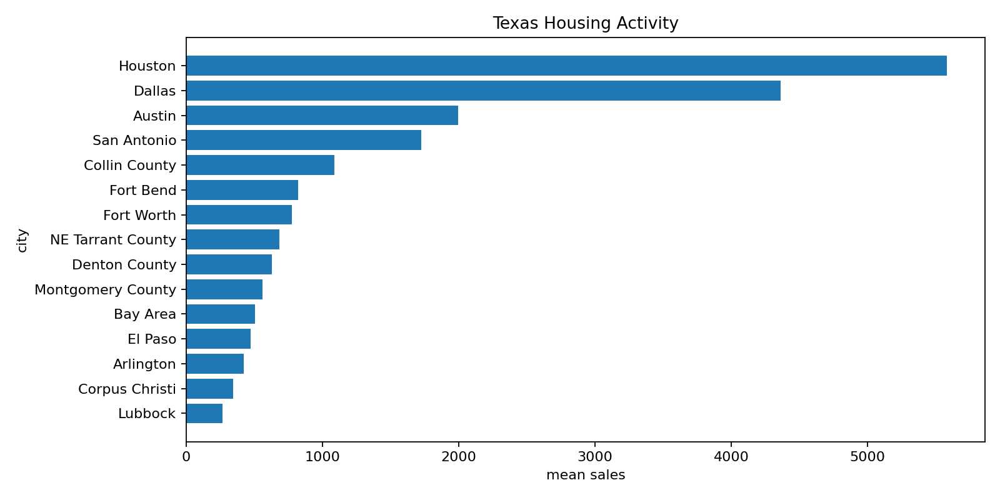

# Texas Housing Activity — executed results

## Decision question
How does monthly sales volume differ across cities?

## Evidence
The largest observed mean sales is 5,582.882 for Houston. This ranking is descriptive, not a recommendation.

Raw rows: 8,602. Rows used: 8,034. Excluded for missing/nonfinite required values or invalid denominator: 568.

## Method
Complete-case descriptive comparison of sales by city; show group counts, mean, minimum and maximum.

## Interpretation and limitations
Mean monthly sales depends on city size and available months; missing months are not zero sales. No causal inference, significance claim or production deployment is implied. Missing values are not imputed; identical rows are retained. Small or repeated samples limit uncertainty interpretation.

## Recommended next decision
Compare matched calendar periods and normalise by housing stock.

## Reproducibility
Source and exact downloaded-byte SHA256 are recorded in run_manifest.json. SQL results are in answer.csv and analysis.sqlite. Review quality_audit.csv before interpretation.
